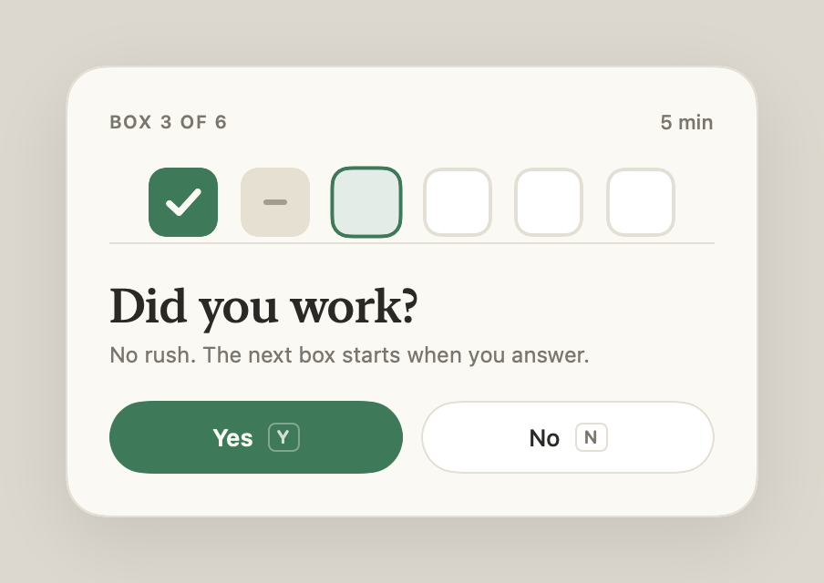
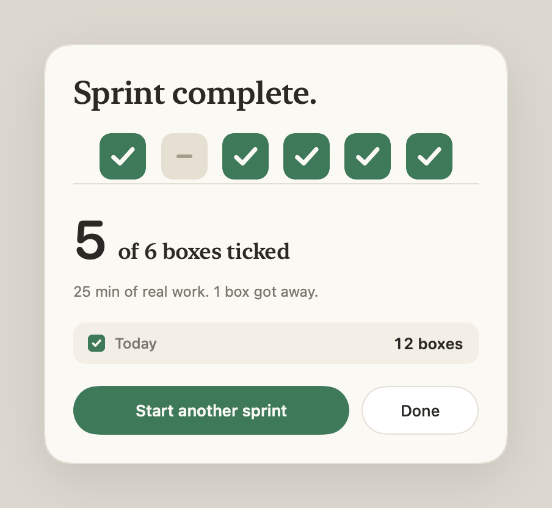
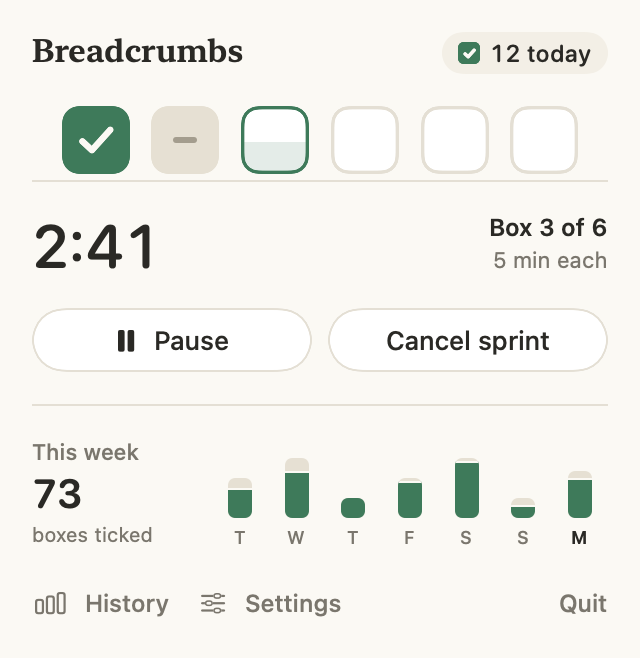
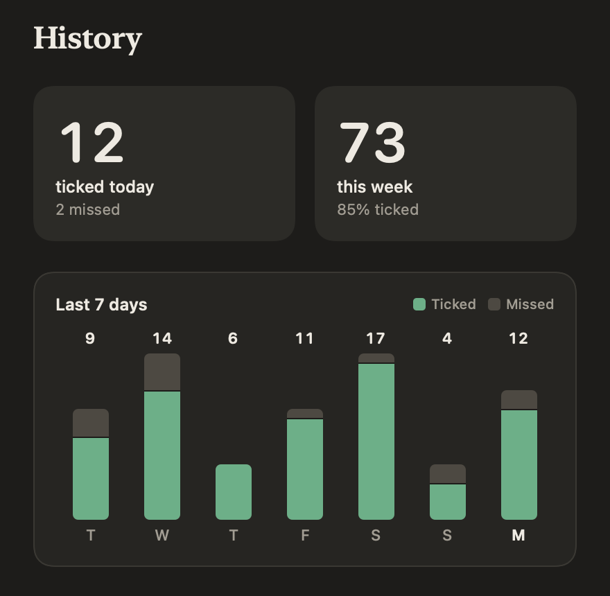

# Breadcrumbs

A calm box-sprint timer for the Mac menu bar.

A sprint is a row of small boxes, by default 6 boxes of 5 minutes each. When a box's time is up, a
soft chime plays and a small card asks **"Did you work?"**. Answer **Yes** and the box gets a tick.
Answer **No** and it's marked as missed, in a muted colour, with no red. The next box starts only
when you answer, so time away from your desk never counts.

<p align="center">
  
  
</p>
<p align="center">
  
  
</p>

Everything stays on your Mac. It has no account, no network access and no tracking.

## Install

**Requirements:** macOS 14 (Sonoma) or later, on an Apple Silicon or Intel Mac.

### Option 1: one command (recommended)

Open **Terminal** (press ⌘-Space and type "Terminal"), paste this line, and press Return:

```bash
curl -fsSL https://raw.githubusercontent.com/nishanthappari/breadcrumbs/main/install.sh | zsh
```

It downloads the latest version into your Applications folder (`~/Applications`) and opens it.
Look for the small box icon in your menu bar.

### Option 2: download it yourself

1. Download **Breadcrumbs.zip** from the [latest release](https://github.com/nishanthappari/breadcrumbs/releases/latest).
2. Double-click the zip and drag **Breadcrumbs** into your Applications folder.
3. Open it. macOS will say it can't verify the developer, because this free app isn't registered
   with Apple. Click **Done**, then go to **System Settings → Privacy & Security**, scroll down,
   and click **Open Anyway** next to the Breadcrumbs message. You only have to do this once.

### The first time it runs

- macOS may show a notification that **Breadcrumbs was added to Login Items**. That keeps it in
  your menu bar after a restart. You can turn it off in Breadcrumbs → Settings → Open at login.
- Breadcrumbs doesn't need any permissions.

## How to use it

| To do this | Do this |
|---|---|
| Start a sprint | Click the box in the menu bar → **Start sprint**, or press **⌃⌥B** (Control-Option-B) from anywhere |
| Answer a check-in | Click **Yes** or **No** on the card. To use the keyboard, press ⌃⌥B to focus the card, then **Y**, **N** or **Return** |
| Pause, resume or cancel | Click the menu bar icon during a sprint |
| Change box length or count | Menu bar → **Settings**: 1–60 minutes per box, 1–24 boxes per sprint |
| See your history | Menu bar → **History**: today's count and the last 7 days |

The menu bar shows the time left on the current box while a sprint runs. The rest of the time it
shows how many boxes you've ticked today.

The check-in card never takes over your keyboard, so you can't answer it by accident while you're
typing somewhere else.

## Uninstall

1. Quit Breadcrumbs: menu bar icon → **Quit**.
2. Delete `Breadcrumbs.app` from your Applications folder (`~/Applications`).
3. Optional: remove your history and settings by running this in Terminal:
   ```bash
   rm -rf ~/Library/Application\ Support/Breadcrumbs && defaults delete com.opslab.breadcrumbs
   ```

## For developers

Breadcrumbs is SwiftUI built with Swift Package Manager. The Xcode Command Line Tools are enough.

```bash
swift test                       # sprint state machine, settings, history (22 tests)
scripts/build_app.sh             # universal release build → ~/Applications, then launch
scripts/build_app.sh --package   # build/Breadcrumbs.zip for a GitHub release
```

- `Sources/BreadcrumbsCore` holds the pure logic: the sprint state machine (`SprintEngine`),
  settings and the history log. It is fully unit-tested.
- `Sources/Breadcrumbs` is the app: the menu bar popover, the check-in and completion card, the
  history window, the global shortcut, the chime and the login item.
- History is a JSON file at `~/Library/Application Support/Breadcrumbs/history.json`, with one
  entry per box (`timestamp`, `worked`). `status.json` beside it mirrors the live state.
- The visual direction is in [DESIGN.md](DESIGN.md).
  `.build/release/Breadcrumbs --snapshot <dir>` renders every screen in light and dark.

### URL scheme

Other tools can control the app with `breadcrumbs://` URLs: `start`, `pause`, `resume`, `toggle`,
`cancel`, `today` (opens History), `answer?worked=yes|no`, `done`, and
`settings?interval=5&boxes=6`. For example, `open breadcrumbs://start`.

### Raycast (optional)

`raycast/breadcrumbs` is a small Raycast extension with **Start Sprint**, **Pause/Resume Sprint**
and **Today's Boxes**. To add it to Raycast, run
`cd raycast/breadcrumbs && npm install && npm run dev` once.

## License

MIT
